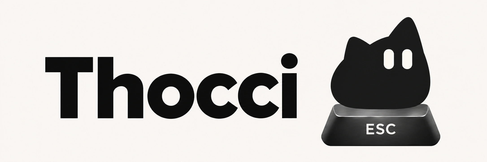
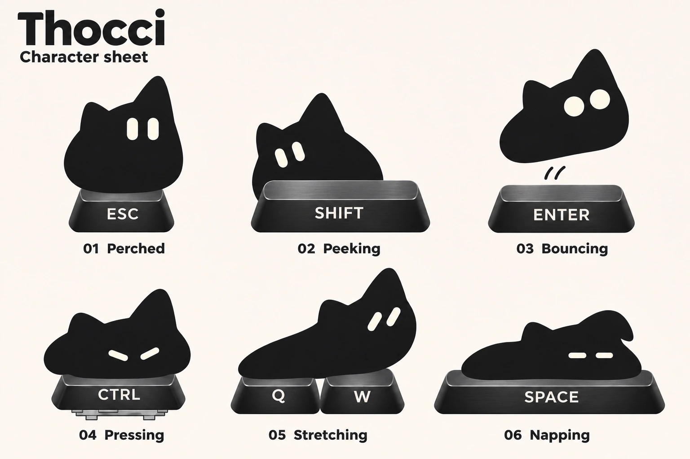

# 

<p align="center">
  <strong>Mechanical keyboard sounds for Windows, Linux, and macOS — desktop app and CLI powered by one Rust engine.</strong>
</p>

<p align="center">
  <a href="#installation">Install</a> ·
  <a href="#desktop-app">Desktop app</a> ·
  <a href="#terminal-guide">Terminal guide</a> ·
  <a href="#permissions">Permissions</a> ·
  <a href="#privacy">Privacy</a>
</p>

Thocci gives your physical keyboard a custom mechanical sound. Choose from 20 built-in soundpacks — from Cherry MX Black and soft Creamy taps to a classic typewriter — or import any local `.wav` clip as your own reusable soundpack. Switch packs or adjust volume live from the desktop dashboard, menu-bar/tray Quick Actions, or the `thocci` CLI. All interfaces share the exact same background engine, active soundpack, and volume setting.

## Installation

The installers download the prebuilt CLI and matching desktop app bundle from [GitHub Releases](https://github.com/ItzEvhyx/Thocci/releases). In a graphical session, the installer launches Thocci directly into the first-launch welcome flow. For headless or CLI-only environments, pass `--cli-only` (Linux/macOS) or `-CliOnly` (Windows) — or set `THOCCI_CLI_ONLY=1` — to install only the CLI and display the terminal welcome.

### Windows

Open PowerShell on Windows (x64) and run:

```powershell
Invoke-RestMethod https://raw.githubusercontent.com/ItzEvhyx/Thocci/main/install.ps1 | Invoke-Expression
```

The installer places `thocci.exe` and `thocci-app.exe` in `%USERPROFILE%\.local\bin`, adds that folder to your user `PATH`, creates a **Thocci** Start Menu shortcut, and opens the desktop app. Open a new PowerShell window if `thocci` is unavailable in the current one.

### Linux and macOS

Run these commands in your terminal. Supported targets: Linux x64 & ARM64 (glibc) and macOS Intel & Apple silicon.

```bash
curl -fsSLo thocci-install.sh https://raw.githubusercontent.com/ItzEvhyx/Thocci/main/install.sh &&
  bash ./thocci-install.sh
```

- **macOS** installs the `thocci` CLI to `~/.local/bin/thocci` and `Thocci.app` to `/Applications` (or `~/Applications`), then opens Thocci.
- **Linux** installs `thocci` and `thocci-app` to `~/.local/bin`, registers the official ESC icon and desktop launcher (`~/.local/share/applications/thocci.desktop`), and launches Thocci when `DISPLAY` or `WAYLAND_DISPLAY` is active.

## Desktop app

- **First launch:** Opens the welcome screen once; clicking **Get started** transitions into the dashboard and enables Quick Actions when supported by your desktop environment.
- **Dashboard:** Light and charcoal dark themes, playback toggle, 0–100% volume slider, live Soundpacks sidebar with search, local `.wav` import, animated **Thocci** mascot stage, and an interactive 79-key Portuguese ISO keyboard preview.
- **Quick Actions:** Compact menu-bar / system-tray popover with Thocci's pointer-following eyes, playback toggle keycap, Settings gear, and the `S W I T C H E S` shortcut straight into Soundpacks.
- **Linux X11 & Wayland fallbacks:** Because AppIndicator does not emit tray icon-click events on Linux, the tray menu exposes **Quick Actions**, **Enable/Disable Thocci**, **Open Dashboard**, **Browse Soundpacks**, and **Quit Thocci**. Desktops without a tray host can launch Thocci from the application menu and access Quick Actions and Quit directly from the dashboard.

## Permissions

- **macOS:** Open **System Settings → Privacy & Security → Input Monitoring** and allow Thocci (the capture binary shown in the in-app **Setup guide**). Return to Thocci and toggle playback, relaunching if macOS prompts.
- **Linux:** Keyboard capture uses `/dev/input/event*` (`evdev`) on both X11 and Wayland. Run `sudo usermod -aG input "$USER"`, then log out and sign back in.
- **Windows:** Uses the interactive-session keyboard hook with no extra setup. Elevate Thocci if you want sounds inside Administrator windows.

Even while background permissions are pending or playback is off, the dashboard, soundpack browser, and pointer/touch key auditions remain available.

## Terminal guide

Start Thocci and type a few keys. Switch to Creamy and set volume to 40%:

```bash
thocci on
thocci creamy
thocci volume 40
```

| Command | What it does |
| --- | --- |
| `thocci on` / `thocci off` | Start or stop keyboard sounds. |
| `thocci toggle` | Turn sounds on or off with one command. |
| `thocci packs` | Browse the 20 built-in soundpacks and any imported WAV packs. |
| `thocci pack "Wooden Keyboard"` | Switch by pack ID, display name, or unique partial match (`thocci creamy` is the short form). |
| `thocci volume 40` | Set the volume from 0 to 100. |
| `thocci on --pack "./my-pack"` | Start with a custom soundpack folder. |
| `thocci guide` / `thocci --help` | Open the built-in terminal guide. |
| `thocci --plain guide` | Open the guide without ANSI colors. |

## Privacy

**Thocci has no data collection or telemetry.** While sounds are enabled, it listens for physical key presses and releases solely to play the corresponding sounds locally on your device. Local WAV imports stay on your device. Thocci never logs, stores, or transmits what you type.

## Meet Thocci

Thocci is the app's black, cat-eared mascot. His favorite spot is the spacebar.



Thocci is open source under the [MIT License](LICENSE).
