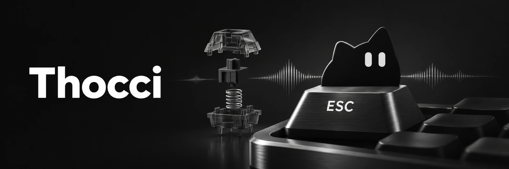
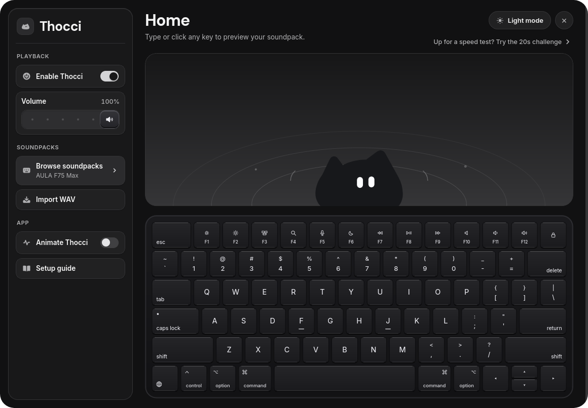
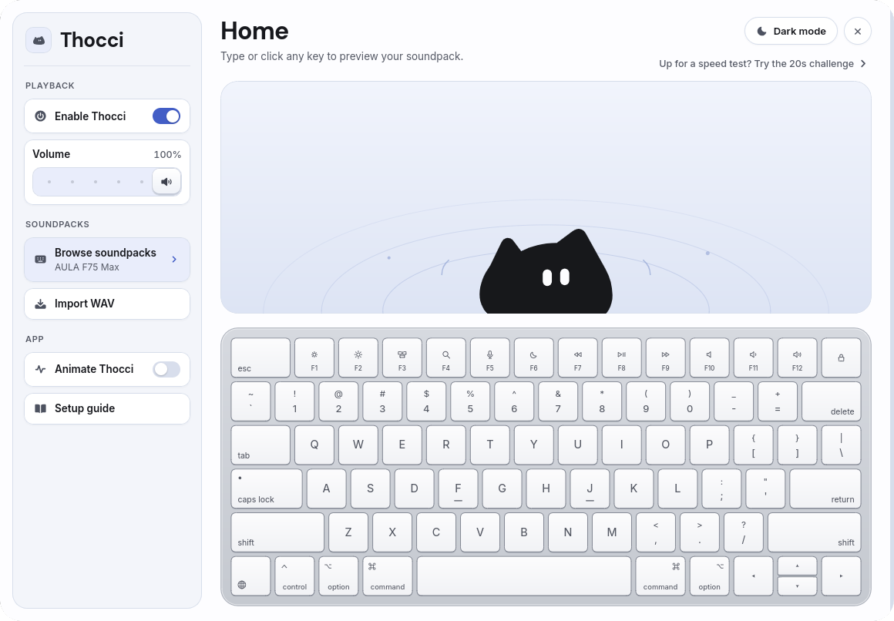
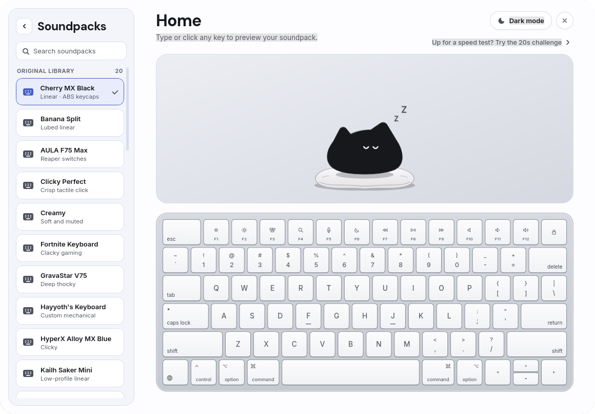
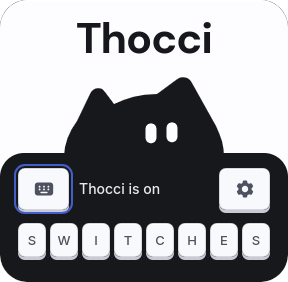

# 

<p align="center">
  <strong>Give your keyboard a sound of its own.</strong><br>
  Mechanical key sounds for Windows, macOS, and Linux.
</p>

<p align="center">
  <a href="#desktop-app">Desktop app</a> ·
  <a href="#installation">Install</a> ·
  <a href="#permissions">Permissions</a> ·
  <a href="#terminal-guide">Terminal guide</a>
</p>

Soft linear taps, crisp clicks, or a classic typewriter. Pick from 41 built-in soundpacks or import a WAV of your own. Your soundpack and volume stay in sync across the desktop app, tray, and terminal.

## Desktop app

### Play every key



Adjust volume, type or click any key to audition the active soundpack, and try a 20-second typing challenge.

<details>
<summary>See Home in light mode</summary>



</details>

### Find your sound



Search the built-in library and switch packs live. Try the Reaper switches from the AULA F75 Max, the softer Creamy pack, or your own WAV.

### Quick Actions

<p align="center">
  
</p>

Toggle playback from the tray or menu bar, open Settings, or jump straight to Soundpacks with **SWITCHES**. On Linux, open Quick Actions from the tray menu or from the dashboard on desktops without a tray host.

## Installation

Prebuilt desktop installers and CLI binaries are published on [GitHub Releases](https://github.com/ItzEvhyx/Thocci/releases) — no Rust, Node.js, or build tools are required.

### Download installer (recommended)

Direct downloads always point to the latest release — ready to run without opening a terminal.

| Platform | Direct download | Notes |
| --- | --- | --- |
| **Windows** (x64) | [**Thocci-Setup-x64.exe**](https://github.com/ItzEvhyx/Thocci/releases/latest/download/Thocci-Setup-x64.exe) | Per-user installer (no admin prompt required). Adds a Start Menu shortcut and uninstaller. |
| **macOS** (Apple Silicon & Intel) | [**Thocci-macOS.dmg**](https://github.com/ItzEvhyx/Thocci/releases/latest/download/Thocci-macOS.dmg) | Universal `.dmg` (or download [Apple Silicon](https://github.com/ItzEvhyx/Thocci/releases/latest/download/Thocci-macOS-AppleSilicon.dmg) / [Intel](https://github.com/ItzEvhyx/Thocci/releases/latest/download/Thocci-macOS-Intel.dmg)). Drag **Thocci** to Applications. |
| **Linux** (Debian / Ubuntu) | [**Thocci-Linux-x64.deb**](https://github.com/ItzEvhyx/Thocci/releases/latest/download/Thocci-Linux-x64.deb) · [**Thocci-Linux-arm64.deb**](https://github.com/ItzEvhyx/Thocci/releases/latest/download/Thocci-Linux-arm64.deb) | Other distros (Arch, Fedora, NixOS, etc.) can use the one-line terminal installer below. |

### Install via terminal (desktop app + CLI)

The installers below download both the desktop app and the `thocci` CLI from the latest release and register Thocci in your OS app launcher. For CLI-only installs, pass `-CliOnly` on Windows or `--cli-only` on macOS and Linux.

#### Windows · x64

Open PowerShell and run the installer.

```powershell
Invoke-WebRequest -Uri https://raw.githubusercontent.com/ItzEvhyx/Thocci/main/install.ps1 -OutFile .\install-thocci.ps1
.\install-thocci.ps1
```

The installer puts the binaries in `%USERPROFILE%\.local\bin`, adds that folder to your user `PATH`, and creates a **Thocci** Start menu shortcut. Open a new PowerShell window if the `thocci` command is missing.

#### macOS · Apple silicon and Intel

```bash
curl -fsSLo thocci-install.sh https://raw.githubusercontent.com/ItzEvhyx/Thocci/main/install.sh &&
  bash ./thocci-install.sh
```

Open **Thocci** from Applications. The installer uses `~/Applications` if the system Applications folder is unwritable and places the CLI in `~/.local/bin`. Follow the [Input Monitoring setup](#permissions) for system-wide sound.

#### Linux · x64 and ARM64 on glibc

```bash
curl -fsSLo thocci-install.sh https://raw.githubusercontent.com/ItzEvhyx/Thocci/main/install.sh &&
  bash ./thocci-install.sh
```

Open **Thocci** from your application launcher. The installer puts both binaries in `~/.local/bin` and adds a desktop entry. Add that directory to your shell's `PATH` if you plan to use the CLI. System-wide sound uses the [input group setup](#permissions) on X11 and Wayland.

### Run from source

Install Git, [stable Rust](https://rustup.rs/), and [Node.js 22](https://nodejs.org/). Then set up your platform's native dependencies.

| Platform | Prerequisites |
| --- | --- |
| Windows | Visual Studio Build Tools with **Desktop development with C++**, the MSVC Rust toolchain, and Microsoft Edge WebView2. |
| macOS | Xcode Command Line Tools. Run `xcode-select --install` if needed. |
| Linux | WebKitGTK 4.1, GTK 3, ALSA, and the other desktop build dependencies below. |

See the [Tauri prerequisites](https://v2.tauri.app/start/prerequisites/) for platform setup and package names on other Linux distributions. On Ubuntu or Debian, install the dependencies used by Thocci's build.

```bash
sudo apt update
sudo apt install build-essential curl libasound2-dev libwebkit2gtk-4.1-dev \
  libgtk-3-dev libayatana-appindicator3-dev librsvg2-dev patchelf
```

On any of the three platforms, clone the repository and launch the desktop app.

```sh
git clone https://github.com/ItzEvhyx/Thocci.git
cd Thocci
npm ci
npm run dev
```

Use `npm run build` to create local desktop bundles under `target/release/bundle/`. For a CLI-only build, run `cargo install --path crates/thocci-cli --locked` from the repository root.

## Permissions

- **Windows** uses the interactive-session keyboard hook. Thocci generally needs to run at the same privilege level as the apps you type in.
- **macOS** uses **System Settings → Privacy & Security → Input Monitoring**. Allow the capture binary shown in Thocci's **Setup guide**, then toggle playback or relaunch if prompted.
- **Linux** uses `/dev/input/event*` for keyboard capture. Run `sudo usermod -aG input "$USER"`, then sign out and back in.

You can browse soundpacks and click the on-screen keys while setting up system-wide playback.

## Terminal guide

```bash
thocci on
thocci creamy
thocci volume 40
```

| Command | What it does |
| --- | --- |
| `thocci on` / `thocci off` | Start or stop keyboard sounds. |
| `thocci toggle` | Switch playback on or off. |
| `thocci packs` | List the built-in soundpacks and imported WAV packs. |
| `thocci pack "Wooden Keyboard"` | Select a pack by ID, name, or unique partial match. |
| `thocci volume 40` | Set the volume from 0 to 100. |
| `thocci on --pack "./my-pack"` | Start with a custom soundpack folder. |
| `thocci guide` / `thocci --help` | Open the terminal guide or command help. |
| `thocci --plain guide` | Open the guide without ANSI colors. |

## Privacy

Playback and WAV imports stay on your device. Thocci listens for physical key events while playback is enabled and uses them to play local sounds. It does not collect telemetry, log your keystrokes, or transmit what you type.

## License

[MIT License](LICENSE)
